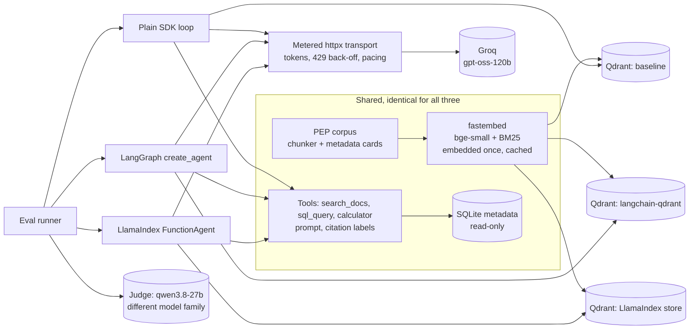

# agent-frameworks-bench

One document-QA agent, built three ways and measured head to head:

1. **Plain SDK baseline**: `openai` client + `qdrant-client`, a hand-written tool-calling loop (the design of [rag-agent-evals](https://github.com/sinouw/rag-agent-evals)).
2. **LangChain + LangGraph**: `langchain-qdrant` hybrid retrieval and the prebuilt tool-calling agent (`langchain.agents.create_agent`, LangGraph underneath).
3. **LlamaIndex**: `VectorStoreIndex` over `llama-index-vector-stores-qdrant` in hybrid mode and the workflow-based `FunctionAgent`.

Corpus, chunks, embeddings, tools, prompt, LLM and eval suite are identical. Only the orchestration and the retrieval integration change. Every number below comes from a run whose raw output is committed under [`results/`](results/).

Versions: langchain 1.4.7, langgraph 1.2.18, langchain-qdrant 1.1.0, llama-index-core 0.14.25, llama-index-vector-stores-qdrant 0.10.4, openai 2.54.0, qdrant-client 1.20.0 (all pinned in `uv.lock`).

> **Status (2026-10-28): end-to-end correctness and faithfulness are pending.** Groq's free tier caps each model at 200,000 tokens per rolling 24 hours, and this key is shared with other work. The judge model's daily window was already used up by other work, so no answer has been graded yet. The answer model ran out with 10 of the 14 eval questions answered by all three frameworks. For those 10 questions, the retrieval metrics, tool selection, citations, tokens, latency and cost below are complete. The judge pass and the remaining 4 questions are scheduled for 2026-10-29. Both passes resume where they stopped (`uv run afbench e2e && uv run afbench judge`). No correctness rate is shown until every answer in the set has been judged.

## What I found

- **On identical tool paths, the frameworks send almost the same tokens.** For the same question and the same tool calls, input tokens were within about 2%. LangChain's prompts are slightly smaller because it strips the `title` fields from the tool JSON schemas. LlamaIndex's are slightly larger because it adds `strict` and `additionalProperties` to them. On q01, for example: 2,093 / 2,115 / 2,151 input tokens for LangGraph / baseline / LlamaIndex. Bigger differences came from the model's own choices on a given run: on q21 the baseline searched twice, while the other two searched once.
- **The frameworks' retrieval defaults are not the baseline's, and nothing warns you.** I found three by reading the integration source, then measured them:
  - `langchain-qdrant` creates the BM25 sparse vector **without Qdrant's IDF modifier**, which the `Qdrant/bm25` model relies on. Answer-chunk MRR drops from 0.72 to 0.68 (hard set: 0.56 → 0.52). One `sparse_vector_params` argument fixes it.
  - It also prefetches only `k` candidates per retriever before fusion. With IDF on, this made no difference on this corpus (0.72 either way).
  - LlamaIndex fuses dense and sparse results client-side with **relative score fusion**, not RRF. It also encodes BM25 queries with the document-side encoder. And it **silently drops IDF** when you pass your own sparse functions instead of a fastembed model name. Its relative score fusion over 20 candidates was the best variant measured (answer-chunk Hit@5 91%, MRR 0.74).
- **Step budgets behave differently.** At the step limit, the baseline and LlamaIndex (`early_stopping_method="generate"`) ask the model for a final answer. The prebuilt LangGraph agent raises `GraphRecursionError` instead. That mattered on q30, an unanswerable question where the model kept searching. After four searches, the baseline and LlamaIndex answered that the documents don't say, which is the right answer. LangGraph ran a fifth search and returned nothing. Getting the graceful behaviour in LangGraph means a custom graph or middleware, which gives back part of its line-count advantage.
- **Framework overhead is small next to LLM time.** The median time not spent waiting on the LLM (retrieval, query embedding on CPU, framework code) was 138 ms for the baseline, 139 ms for LangGraph and 192 ms for LlamaIndex. End-to-end medians were 1.2–1.6 s.
- **Code size.** LangGraph needs the least code: 107 lines, against 140 each for the baseline and LlamaIndex. LlamaIndex's 140 include 19 lines of RRF fusion, written only to match the baseline's retrieval.

## Results

Hardware for every timing below: 2019 MacBook Pro, Intel Core i7-9750H (6 cores), 16 GB RAM, CPU only, shared with other workloads during the runs. LLM calls go to Groq's hosted API.

### Retrieval (no LLM; 48 golden questions that name their source documents, 45 of them with an answer-bearing passage)

From [`results/retrieval.json`](results/retrieval.json) (`uv run afbench retrieval`). Every variant searches the same 1,251 chunks with the same vectors.

| Variant | Doc Hit@1 | Answer-chunk Hit@5 | Answer-chunk MRR | MRR core / hard | p50 latency |
|---|---|---|---|---|---|
| **baseline** (dense + BM25 with IDF, RRF over 20 candidates each) | 96% | 89% | 0.72 | 0.88 / 0.56 | 82 ms |
| langchain: defaults | 96% | 89% | 0.68 | 0.83 / 0.52 | 82 ms |
| langchain: IDF | 96% | 89% | 0.72 | 0.86 / 0.57 | 78 ms |
| **langchain: IDF + 20 candidates** (used by the agent) | 96% | 89% | 0.72 | 0.88 / 0.56 | 84 ms |
| llamaindex: defaults | 96% | 89% | 0.72 | 0.88 / 0.56 | 82 ms |
| llamaindex: 20 candidates | 96% | 91% | 0.74 | 0.90 / 0.57 | 95 ms |
| llamaindex: 20 candidates + BM25 query encoding | 96% | 91% | 0.74 | 0.90 / 0.57 | 74 ms |
| **llamaindex: 20 candidates + BM25 query encoding + RRF** (used by the agent) | 96% | 89% | 0.72 | 0.88 / 0.56 | 85 ms |

*Answer chunk*: a top-5 chunk from the right document contains the evidence text recorded in the golden set. The baseline reproduces the reference repo's published figures (89%, 0.72). Both matched framework variants return exactly the baseline's metrics, so the end-to-end agents below retrieve the same way.

### End to end (10 questions, answer model `openai/gpt-oss-120b`)

From [`results/summary.md`](results/summary.md), built from the raw rows in [`results/e2e/main.jsonl`](results/e2e/main.jsonl). Latency, calls, tokens and cost cover the 9 questions that all three answered without an error. Rate-limit waiting is recorded separately and excluded from latency.

| Framework | Correct / faithful | Citation precision | Tool selection | p50 / p95 latency | p50 non-LLM time | LLM calls | Tokens in / out | Cost / question | Errors |
|---|---|---|---|---|---|---|---|---|---|
| baseline | pending (judge) | 92% | 90% | 1,215 / 3,094 ms | 138 ms | 2.3 | 2,506 / 280 | $0.00054 | 0 |
| LangGraph | pending (judge) | 92% | 90% | 1,533 / 2,816 ms | 139 ms | 2.2 | 2,101 / 236 | $0.00046 | 1 |
| LlamaIndex | pending (judge) | 92% | 90% | 1,613 / 3,454 ms | 192 ms | 2.3 | 2,276 / 255 | $0.00049 | 0 |

- **Tool selection** means the run called the tool the question needs: SQL or the calculator where the golden set names one, document search otherwise. All three miss the same question. On q27 each implementation stated the 79 − 72 difference without calling the calculator, as the reference agent also did.
- **Errors**: LangGraph's one error is q30 hitting the step budget, described above. LangGraph also failed q31: after four searches, its fifth request was 8,057 tokens, over Groq's 8,000 tokens-per-minute limit for a single request. That question isn't in the table yet, because the baseline's q31 run is still pending.
- **Cost** uses Groq's list price for `openai/gpt-oss-120b`: $0.15 input / $0.60 output per million tokens ([console.groq.com/docs/models](https://console.groq.com/docs/models), read 2026-10-28). It excludes judge calls.
- **The question set** is a fixed, rule-based subset of the 65 golden questions (`evals.select_subset`): the first 3 core and first 3 hard lookups, then the first 2 questions of every other category, in file order. The shared free-tier quota set its size; no questions were hand-picked.

### Code size and start-up

| | Baseline | LangGraph | LlamaIndex |
|---|---|---|---|
| Logical lines of code ([`results/loc.json`](results/loc.json); no blanks, comments or docstrings) | 140 | 107 | 140 |
| Cold import time, 5 runs, min–max ([`results/import-times.txt`](results/import-times.txt)) | 5.5–6.4 s | 6.6–7.7 s | 5.3–7.9 s |

Shared code (corpus loading and chunking, tool implementations, embeddings) is 531 lines, the same for all three. Each framework's count includes its index build, retriever wrapper, tool wrappers and agent. LangGraph's and LlamaIndex's also include the small adapters that put the shared embedder behind their embedding interfaces. Import times were measured on a busy machine: read them as "all similar", not as a ranking.

### Indexing ([`results/index.json`](results/index.json))

The corpus is embedded once (dense `bge-small-en-v1.5` + BM25, fastembed ONNX on CPU), which took 286 s for 1,251 chunks. All three implementations share that cache, so the numbers below are only each framework's overhead for writing its index:

| | Baseline | LangChain (2 collections: default and IDF) | LlamaIndex |
|---|---|---|---|
| Write index from cached vectors | 3.4 s | 7.5 s | 3.6 s |

## Trade-offs

**Debuggability.** The baseline is the easiest to step through: it is one function, and its messages list is the whole state. For the frameworks, the most useful debugging tool was the HTTP layer, not their callbacks. Each implementation accepts a custom `httpx` client, so one metering transport ([`src/afbench/transport.py`](src/afbench/transport.py)) sees exactly what each one sends. That is how I found the request-shape differences: LlamaIndex sends `parallel_tool_calls`, `tool_choice` and `strict` schemas, and defaults to temperature 0.1 unless told otherwise.

**Control.** Everything I needed was reachable in all three. In the frameworks, though, it sat behind defaults I had to read the source to find: fusion method, candidate pool, IDF, query-side BM25 encoding, step-limit behaviour. None of those defaults is wrong in general. Each is a decision someone else made about your retrieval, and it takes an eval like this one to notice it.

**Abstraction cost.** On this workload the runtime cost was low: tens of milliseconds, and about the same tokens. The real cost is surface area: two more dependency trees to track. One example: the dense `FastEmbedEmbeddings` class that LangChain documents lives in `langchain-community`, which now warns that it is being sunset. This repo wraps the shared embedder in LangChain's interface instead of using it.

**Where each helped.** LangGraph's prebuilt agent was the shortest path to a working tool loop. LlamaIndex's `early_stopping_method="generate"` gave a graceful step limit for free, and its default fusion slightly out-ranked RRF here. The baseline needed no adaptation to anything, and it was the only one whose behaviour I could predict without reading library code.

## Architecture



What keeps the comparison fair:

- **Same inputs.** Every store indexes the same chunks with the same embedding text. One embedder instance serves all three, so query vectors are identical too.
- **Same tools.** Names, descriptions and pydantic argument schemas are identical, and so is behaviour: each framework's tool wrapper calls the same `ToolBox` methods. Tests assert that all three offer the same three tools and send the same model and temperature.
- **Same transport.** SDK retries are disabled everywhere. One transport handles HTTP 429s and paces requests against the tokens-per-minute and requests budgets in Groq's `x-ratelimit-*` headers, and that waiting is recorded apart from latency. Token counts come from the provider's `usage` field on the wire, not from each framework's own accounting.
- **Same conditions.** Questions run one at a time, and the framework order rotates per question.

## Reproduce

Requires Python 3.12 and [uv](https://docs.astral.sh/uv/). No GPU, no Docker, no PyTorch.

```bash
cp .env.example .env              # add a GROQ_API_KEY (free tier works)
uv sync
uv run afbench index              # embed once + build the three indexes (no key; ~5 min on the laptop above)
uv run afbench retrieval          # retrieval table (no key)
uv run afbench budget             # tokens the remaining e2e + judge work will spend, per model (no key)
uv run afbench probe              # one tiny request per model: is its daily window free?
uv run afbench e2e                # answer the eval subset with each framework (resumable)
uv run afbench judge              # grade the answers, one at a time (resumable)
uv run afbench report             # results/summary.{md,json}
uv run afbench ask langgraph "Which PEP introduced the walrus operator?"
```

`e2e` and `judge` probe their model first and don't start while its daily window is spent; `--wait-for-quota HOURS` waits for it instead. Every successful completion is cached under `data/cache/llm/`, keyed by the exact request, so a run interrupted mid-question replays the calls it already paid for. A replayed call counts at its original HTTP time, and the row records how many calls were replayed (`replayed_calls`).

`make bench` runs the whole chain. The Dockerfile builds the indexes at image build time. I haven't built the image: there is no Docker on the machine this was made on.

## Tests and checks

```bash
make check     # ruff lint + format check, mypy, pytest (51 tests)
```

The tests run offline:

- Each framework's real agent code runs against a scripted OpenAI-compatible backend, through the same metered transport. The tests cover tool calls, citations, errors, step-budget behaviour and request shape.
- Each framework's index-and-search path runs on in-memory Qdrant with hashing embedders.
- Also covered: the transport's back-off, pacing, quota handling and response cache; the token budget and quota probe; the embedding cache; the eval metrics; and the resumable answer and judge passes.

`make check` passes locally. `.github/workflows/ci.yml` runs the same checks, the keyless retrieval eval with a quality gate, and the Docker build. CI has not run yet, because the repository has not been pushed.

## Limitations

- End-to-end quality (correctness, faithfulness) is pending, as described at the top.
- 10 to 14 questions is a small sample. It shows the three implementations behave alike on this workload, but it cannot rank small quality differences. The retrieval eval over 48 questions is the more reliable comparison.
- I wrote the golden set by hand after reading the documents. Each PEP covers one topic, which makes document-level retrieval easy, so the answer-chunk metric is the more informative one.
- Each question ran once, so nondeterminism in the model's tool choices (see q21) shows up but is not averaged out.
